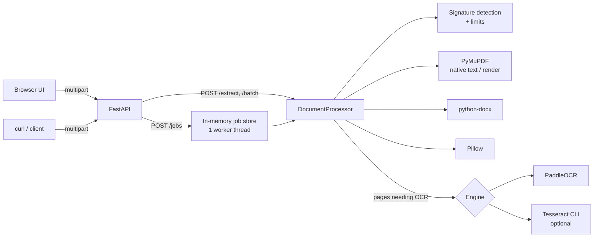

# OCR Platform

Multilingual (English, French, Arabic) document extraction service. Upload an image, PDF or DOCX; get plain text or structured JSON. CPU only, runs locally, no GPU or CUDA needed.

- REST API (FastAPI) with an **asynchronous job API**: upload a file, get a transaction UUID, poll for the result.
- Browser UI served by the same server (vanilla HTML/CSS/JS, no Node.js).
- PaddleOCR (primary), Tesseract (optional), native text extraction for PDF / DOCX / TXT.

## Quick start: how to run the app

Tested on macOS Apple Silicon (Python 3.11, `uv`). Run these from the project folder.

**1. One-time setup**

```bash
uv venv --python 3.11 .venv
source .venv/bin/activate
uv pip install -e ".[dev]"
```

No `uv`? `python3.11 -m venv .venv && source .venv/bin/activate && pip install -e ".[dev]"` should work but was not run.

**2. Start the server** (every time)

```bash
source .venv/bin/activate
uvicorn app.main:app --host 127.0.0.1 --port 8000
```

The first OCR request downloads ~141 MB of models (about 40 s), then everything runs offline. Stop the server with `Ctrl+C`.

**3. Use it**

| What | How |
|---|---|
| Browser UI | Open <http://127.0.0.1:8000/> and drop a file |
| API docs (Swagger) | <http://127.0.0.1:8000/docs> |
| Submit a document (async) | `curl -s -F file=@samples/scanned.pdf -F languages=en -F languages=fr http://127.0.0.1:8000/api/v1/ocr/jobs` returns a `job_id` |
| Poll for the result | `curl -s http://127.0.0.1:8000/api/v1/ocr/jobs/<job_id>` |
| Get the text only | `curl -s http://127.0.0.1:8000/api/v1/ocr/jobs/<job_id>/text` |
| Check the server | `curl -s http://127.0.0.1:8000/health` |

Sample files are in `samples/` (English, French, Arabic images, scanned/searchable/mixed PDFs, a DOCX).

**4. Run the tests**

```bash
source .venv/bin/activate
pytest -m "not integration"       # 84 unit/API tests, no models needed
pytest -m integration -rs         # real OCR, needs the models (downloads on first run)
```

**Change the port or limits:** use `--port 9000`, or copy `.env.example` to `.env` and edit it (see [Start](#start)).

**Optional Tesseract engine** (macOS): `brew install tesseract tesseract-lang`, restart the server, then send `-F engine=tesseract`.

## Architecture



Every endpoint calls the same `DocumentProcessor.process()`.

## Supported formats and languages

| Format | Handling |
|---|---|
| PNG, JPEG, TIFF (multi-frame), BMP, WEBP | OCR. Each frame is a page |
| PDF | Per page: embedded text if enough, otherwise render + OCR |
| DOCX | Paragraphs and tables extracted in document order. Never OCR-ed |
| TXT | UTF-8 text returned as one page |
| DOC, RTF | **Not implemented** (would need LibreOffice) |

Format is detected from file content, not from the extension or client content type.

| Language | Code | PaddleOCR models actually used |
|---|---|---|
| English, French | `en`, `fr` | PP-OCRv6 medium detector + PP-OCRv6 medium recognizer (Latin script; accents verified) |
| Arabic | `ar` | PP-OCRv6 medium detector + `arabic_PP-OCRv5_mobile_rec` |

PaddleOCR loads **one recognition model per request**. A request containing `ar` uses the Arabic model, which also reads Latin letters and digits (verified on English text, see test results). Automatic language detection is **not available**; select the languages in the document. `detected_languages` in the JSON is always `null`.

## Processing modes

| Mode | Meaning |
|---|---|
| `auto` (default) | PDF page with at least `OCR_NATIVE_MIN_CHARS` (20) characters of embedded text is read natively; other pages and all images are OCR-ed |
| `native` | Embedded/editable text only. Never runs OCR. Scanned PDF pages come back empty with a warning. Images are rejected (422) |
| `ocr` | Always OCR images and PDF pages. A PDF page's embedded text is **kept** in `native_text` next to the OCR `text`. For DOCX/TXT the text is extracted natively and a warning says so |

Engine selection: `paddleocr`, `tesseract`, or `auto` (= PaddleOCR; Tesseract only if PaddleOCR is not installed and Tesseract has the languages). An explicit engine that is unavailable returns an error. There is no switch after a runtime failure. When `auto` skips an engine, the reason is added to `warnings`.

## Prerequisites (CPU only)

- Python 3.11 (3.10–3.13 are allowed by `pyproject.toml`; only 3.11 was tested)
- ~3 GB free RAM for dense pages (see [measurements](#measured-resource-usage))
- ~141 MB disk for models, plus ~1 GB for the Python packages
- Internet on first OCR request to download models (afterwards fully offline)

No CUDA, no GPU libraries. The default install is `paddlepaddle` (the CPU wheel).

## Installation: macOS Apple Silicon (tested)

Tested on macOS, Apple M4 Pro, Python 3.11.16, using `uv`.

```bash
cd python_ocr_app
uv venv --python 3.11 .venv
source .venv/bin/activate
uv pip install -e ".[dev]"        # drop [dev] for runtime only
```

Pinned, known-good versions from the tested environment (macOS arm64, Python 3.11): `uv pip install -r requirements-lock.txt`.

Key versions: `paddlepaddle==3.3.1`, `paddleocr==3.7.0` (pulls `paddlex 3.7.2`), `pymupdf==1.28.2`, FastAPI 0.162.0, Pillow 13.0.0.
`pymupdf` is pinned to 1.28.2 on purpose: 2.0 pulls in `onnxruntime`, `pymupdf-layout` and `pymupdf4llm`, which this project does not use.

Plain `pip install -e ".[dev]"` should be equivalent but was not run.

## Installation: Linux (not tested here)

```bash
python3.11 -m venv .venv
source .venv/bin/activate
pip install -e ".[dev]"
sudo apt-get install -y libgl1 libglib2.0-0 libgomp1   # runtime libs for OpenCV / Paddle
```

`paddlepaddle==3.3.1` publishes manylinux CPU wheels, but this project was only run on macOS arm64. Treat the Linux path as unverified.

## Docker (not built here)

```bash
docker compose up --build
```

The `Dockerfile` and `docker-compose.yml` were written but **never built or run**: the Docker daemon was not running in the development environment. Models are stored in the `ocr-models` volume. The port is bound to `127.0.0.1` only.

## Optional: Tesseract

Not needed. To enable it:

```bash
brew install tesseract tesseract-lang          # macOS
sudo apt install tesseract-ocr tesseract-ocr-fra tesseract-ocr-ara   # Debian/Ubuntu
```

The app calls the `tesseract` command (`OCR_TESSERACT_CMD` to override) and reports only the languages whose data (`eng`, `fra`, `ara`) is installed. Verified against Tesseract 5.5.4 (Homebrew) with all three languages: see the test results below. `auto` never picks Tesseract while PaddleOCR is available; request it with `engine=tesseract`.

## Models, cache and first run

- Models download automatically on the first OCR request for a language group, from the PaddleOCR model hosters, into `OCR_MODEL_CACHE_DIR` (default `./models`, git-ignored).
- Measured with an empty cache: **141 MB** (detector 59 MB, Latin recognizer 73 MB, Arabic recognizer 7.8 MB); first request for French + Arabic took **39 s** including download.
- The model-hoster connectivity check is skipped (`PADDLE_PDX_DISABLE_MODEL_SOURCE_CHECK=True`) so cached models work offline. Set the variable yourself to override.
- Load failures (offline, bad cache) return `503 MODEL_UNAVAILABLE` with instructions. To work offline, copy a populated `models/` directory to the target machine.
- `GET /api/v1/ocr/engines` tells you when no models are cached yet.
- Loaded pipelines stay in memory and are reused between requests.

## Start

```bash
source .venv/bin/activate
uvicorn app.main:app --host 127.0.0.1 --port 8000
```

- UI: <http://127.0.0.1:8000/>
- Swagger: <http://127.0.0.1:8000/docs>

Configuration: copy `.env.example` to `.env` (all values shown are defaults, each can also be an `OCR_*` environment variable).

| Variable | Default | Meaning |
|---|---|---|
| `OCR_MAX_UPLOAD_MB` | 25 | Max size per uploaded file |
| `OCR_MAX_PAGES` | 50 | Max PDF pages / image frames. Larger documents are rejected (413) |
| `OCR_RENDER_DPI` | 200 | PDF render resolution for OCR |
| `OCR_MAX_IMAGE_SIDE` | 4000 | Longer side is downscaled to this (pixels) |
| `OCR_MAX_IMAGE_PIXELS` | 100000000 | Larger images are rejected |
| `OCR_PADDLE_DET_MAX_SIDE` | 1280 | Longest side the text detector sees. Lower = less memory and time, may miss small text |
| `OCR_PROCESSING_TIMEOUT_SECONDS` | 600 | Per document; checked between pages |
| `OCR_BATCH_MAX_FILES` | 5 | Files per `/batch` request |
| `OCR_JOB_TTL_SECONDS` | 3600 | How long finished jobs stay available |
| `OCR_JOB_MAX_ACTIVE` | 20 | Queued + running jobs before 429 |
| `OCR_MODEL_CACHE_DIR` | `models` | PaddleOCR model cache |
| `OCR_CORS_ORIGINS` | `[]` | JSON list of allowed origins. Empty = same-origin only |

## API usage

### Asynchronous: submit, then poll

```bash
curl -s -F file=@samples/scanned.pdf -F languages=en -F languages=fr \
     http://127.0.0.1:8000/api/v1/ocr/jobs
# {"job_id":"daa18531-935e-4cc2-b472-0cc65c3e8f89","status":"queued","status_url":"/api/v1/ocr/jobs/daa18531-..."}

curl -s http://127.0.0.1:8000/api/v1/ocr/jobs/<job_id>          # JSON status + result
curl -s http://127.0.0.1:8000/api/v1/ocr/jobs/<job_id>/text      # plain text once completed
```

`status` is `queued`, `processing` (with `pages_done` / `total_pages`), `completed` (`result` set) or `failed` (`error` set). Unsupported, empty or oversized files are rejected immediately on submit; processing errors appear when polling. Unknown or expired job: `404 JOB_NOT_FOUND`.

Jobs are held **in memory** and run one at a time. They are lost on restart.

### Synchronous

```bash
curl -s -F file=@samples/french.png -F languages=fr -F output_format=json \
     http://127.0.0.1:8000/api/v1/ocr/extract

curl -s -F file=@samples/arabic.png -F languages=ar -F output_format=text \
     http://127.0.0.1:8000/api/v1/ocr/extract

curl -s -F files=@samples/english.png -F files=@samples/document.docx -F languages=en \
     http://127.0.0.1:8000/api/v1/ocr/batch
```

Form fields: `engine` (`auto|paddleocr|tesseract`), `languages` (repeat the field or comma-separate), `mode` (`auto|native|ocr`), `output_format` (`json|text`, extract only). The batch endpoint always returns JSON, with one `completed` or `failed` item per file.

Other endpoints: `GET /health`, `GET /api/v1/ocr/engines`.

### Errors

All errors use one schema:

```json
{"error": {"code": "UNSUPPORTED_LANGUAGE", "message": "Unsupported language(s): de. Supported: en, fr, ar."}}
```

Codes: `EMPTY_FILE`, `FILE_TOO_LARGE`, `UNSUPPORTED_FORMAT`, `CORRUPTED_DOCUMENT`, `ENCRYPTED_DOCUMENT`, `PAGE_LIMIT_EXCEEDED`, `IMAGE_TOO_LARGE`, `UNSUPPORTED_LANGUAGE`, `UNSUPPORTED_MODE`, `ENGINE_UNAVAILABLE`, `MODEL_UNAVAILABLE`, `OCR_FAILED`, `TIMEOUT`, `TOO_MANY_JOBS`, `BATCH_TOO_LARGE`, `JOB_NOT_FOUND`, `JOB_NOT_COMPLETED`, `INVALID_REQUEST`, `INTERNAL_ERROR`.

## JSON output contract

- Page numbers start at **1**.
- `bbox` is `[x_min, y_min, x_max, y_max]` as **fractions (0..1) of page width and height, origin top-left**, for OCR and native PDF blocks alike.
- `confidence` is the OCR engine's score (0..1), `null` for native text.
- `extraction.mode` is `native`, `ocr` or `mixed`; each page also has `method`. `engine` is `null` when no page needed OCR.
- DOCX and TXT are one page; `blocks` is empty; DOCX tables are in `tables` (`position` = index among body elements) and also rendered into `text` as tab-separated rows.

Real output (`samples/mixed.pdf`: page 1 has a text layer, page 2 is an image; blocks truncated to one per page):

```json
{
  "document": {"filename": "mixed.pdf", "content_type": "application/pdf", "size_bytes": 1287190, "page_count": 2},
  "extraction": {"engine": "paddleocr", "requested_engine": "auto", "requested_mode": "auto",
                 "mode": "mixed", "requested_languages": ["en"], "detected_languages": null},
  "pages": [
    {"page_number": 1, "method": "native", "text": "Native text page: Relevé de compte", "native_text": null,
     "blocks": [{"text": "Native text page: Relevé de compte", "confidence": null, "bbox": [0.121, 0.1009, 0.4937, 0.1237]}],
     "tables": []},
    {"page_number": 2, "method": "ocr",
     "text": "Loan application number 2024-00123\nApplicant: John Smith\nTotal amount due: $12,500.00",
     "native_text": null,
     "blocks": [{"text": "Loan application number 2024-00123", "confidence": 1.0, "bbox": [0.0947, 0.0686, 0.5888, 0.0959]}],
     "tables": []}
  ],
  "warnings": []
}
```

Text output (`output_format=text` or `/jobs/<id>/text`): a single-page document is returned as-is. A multi-page document gets a `--- Page N ---` line before every page, pages separated by a blank line:

```text
--- Page 1 ---
Loan application number 2024-00123
Applicant: John Smith
Total amount due: $12,500.00

--- Page 2 ---
Relevé de compte bancaire
Échéance le 15 février : 1 250,75 €
Café crème à Noël, où êtes-vous ?
```

## Web UI

Open <http://127.0.0.1:8000/>. Drop or choose a file (name, size and the browser-reported type are shown; the server verifies the real type), pick engine, mode, languages and output format, click **Extract**. The UI uses the asynchronous job API and shows progress per page. Results have **Text** (with page navigation), **JSON** and **Pages** (blocks, confidence, boxes, tables) tabs. Warnings are shown in a separate box. **Download TXT / JSON** save files named from the original filename, reduced to safe characters. Each text line gets its own direction (`dir="auto"`), so Arabic lines render right-to-left; recognized strings are never reversed. The "Output format" selector chooses which tab opens first. **Clear** resets everything.

The UI was served and syntax-checked (`node --check`), but **not exercised in a real browser** during development.

## Tests

```bash
# Unit + API tests: no models, no network (fake OCR engine)
pytest -m "not integration"

# Real OCR with downloaded models. Read the skip reasons: a skip is not a pass
pytest -m integration -rs

# Regenerate the sample documents and ground truth (needs the dev extras and a font with Arabic glyphs)
python scripts/make_fixtures.py
```

Integration tests compute character error rate (CER) against `samples/ground_truth.json` and print it at the end of the run. The fixtures are clean, synthetic renderings. CER 0.0000 on them says nothing about scans, photos, handwriting or small print.

### Test results (macOS arm64, Python 3.11, PaddleOCR 3.7.0)

Unit and API tests: **84 passed**. They also fail when logic is broken (inverting the native-text threshold, dropping `native_text`, or never OCR-ing in `auto` each made 2–10 tests fail).

Integration (real OCR): **14 passed, 1 xfailed, 0 skipped** (Tesseract 5.5.4 installed; without it the 3 Tesseract tests skip, and a skip is not a pass).

| Test | CER |
|---|---|
| English image `[en]` | 0.0000 |
| French image `[fr]` and `[en,fr]` (accents and € preserved) | 0.0000 |
| Arabic image `[ar]` (logical-order Unicode, digits kept) | 0.0000 |
| English image through the Arabic model `[en,ar]` | 0.0000 |
| Scanned PDF, 2 pages `[en,fr]` | 0.0000 / 0.0000 |
| Mixed PDF: page 1 native, page 2 OCR | page 2: 0.0000 |
| Searchable PDF native; forced OCR keeps `native_text` | passed |
| End-to-end job over HTTP with real engine | passed |
| Mixed Arabic/Latin lines: token recall | 0.89 (recall floor 0.7) |
| Tesseract English image `[en]` | 0.0000 |
| Tesseract French image `[fr]` | 0.0000 |
| Tesseract Arabic image `[ar]` | 0.2923 |

- **Tesseract Arabic:** Tesseract itself returns only 2 of the 3 lines (it skips the middle one). The lines it returns are exact and in order, so the app's parser is not the cause. PaddleOCR read all three. Prefer PaddleOCR for Arabic.
- **1 xfailed (known limitation):** mixed Arabic/Latin lines come back in non-logical order, e.g. `Invoice 1500 رقم 2024 مبلغ USD` for `Invoice رقم 2024 مبلغ 1500 USD`. The app does not reorder them.

### Measured resource usage

Apple M4 Pro, 14 cores, CPU only, models cached, peak RSS of the Python process:

| Case | Time | Peak RSS |
|---|---|---|
| Dense English A4 page, 48 lines, 9 pt, 200 DPI (detector cap 1280) | ~32 s | 2.5 GB |
| Dense Arabic A4 page, 30 lines, 11 pt, 200 DPI (detector cap 1280) | ~8 s | 2.2 GB |
| Simple image, 3 lines | ~2 s | — |

- PaddlePaddle CPU inference ran effectively single-threaded here (CPU time ≈ wall time; `OMP_NUM_THREADS`, `OPENBLAS_NUM_THREADS` and `VECLIB_MAXIMUM_THREADS` made no difference). Expect roughly 0.2–0.6 s per text line.
- Without the detector cap PaddleOCR does not downscale at all: one 200-DPI A4 page used ~8 GB. That is why `OCR_PADDLE_DET_MAX_SIDE` exists.
- Detector cap versus accuracy was measured on one synthetic Arabic page (CER 2.3 % at 960, 1.4 % at 1280, 1.2 % at 1600, 3.7 % at 2400) and one English page (0.0 % at 960–2000). Treat 1280 as a reasonable default, not a tuned optimum.
- Pairing the Arabic recognizer with the smaller PP-OCRv6 medium detector instead of PaddleOCR's default PP-OCRv5 server detector cut peak memory from ~9 GB to ~2.2 GB for CER 1.4 % → 2.2 % on that page.

## Troubleshooting

| Symptom | Fix |
|---|---|
| `503 MODEL_UNAVAILABLE` | First request needs internet to download models into `OCR_MODEL_CACHE_DIR`. Check network or copy a populated model directory |
| `503 ENGINE_UNAVAILABLE` for Tesseract | Install the binary and language data, see *Optional: Tesseract* |
| `413 PAGE_LIMIT_EXCEEDED` | Raise `OCR_MAX_PAGES` or split the PDF |
| `504 TIMEOUT` | Dense pages take ~30 s each. Raise `OCR_PROCESSING_TIMEOUT_SECONDS` and use the job API |
| Memory use too high | Lower `OCR_PADDLE_DET_MAX_SIDE` and/or `OCR_RENDER_DPI` |
| Small text missed | Raise `OCR_PADDLE_DET_MAX_SIDE` (costs memory) or `OCR_RENDER_DPI` |
| `ImportError: libGL` / `libgomp` on Linux | `apt-get install libgl1 libglib2.0-0 libgomp1` |
| Job returns 404 | Job expired (`OCR_JOB_TTL_SECONDS`) or the server restarted |

## Known limitations

- Paddle CPU inference is slow and single-threaded on Apple Silicon (see above); the job queue runs one document at a time.
- Mixed Arabic/Latin lines: wrong order and occasional character errors (measured). Complex Arabic layouts and reading order are untested.
- No automatic language detection. Requests with `ar` use the Arabic model for all text.
- Rotated or skewed scans are not corrected (document orientation and unwarping are off for speed). Rotated PDF pages are untested.
- DOC and RTF are not supported. TXT must be UTF-8.
- DOCX: headers, footers, text boxes and nested tables are not extracted. PDF tables are not extracted (only DOCX tables).
- Timeouts are checked between pages; a single very slow page cannot be interrupted.
- Starlette spools a multipart upload before the size check runs. A `Content-Length` guard rejects oversized declared requests, but a client that omits it is only stopped after the upload is received. Enforce limits in a reverse proxy.
- Tesseract was tested only on macOS with the three clean fixtures. Docker build and Linux install were not run. The browser UI was not tried in a browser.

## Security and privacy

This is a local development service, not a hardened public service.

- Local processing only; documents are never sent to an external service. The only outbound traffic is the model download.
- Uploads are streamed to a private temporary directory under a fixed name (`upload.bin`); client filenames are never used as paths and are reduced to a base name. Temporary files are deleted after processing, including on errors and shutdown.
- Content is detected by file signature and must parse; DOCX decompressed size is capped; image pixel count and PDF page count are capped. Documents are never executed; macros are ignored.
- No URL fetching. CORS is closed unless `OCR_CORS_ORIGINS` is set.
- Extracted text is never logged. Logs contain format, page count, mode, engine and duration. Job results (which contain extracted text) stay in memory until `OCR_JOB_TTL_SECONDS` expires.
- Error responses contain no stack traces.

Before exposing it on a network you must add: authentication and authorization (job IDs are unguessable UUIDs but are the only protection), TLS, rate limiting, request-size enforcement at the proxy, persistent per-user job storage if results must survive restarts, audit logging, and a review of retention for financial documents.
